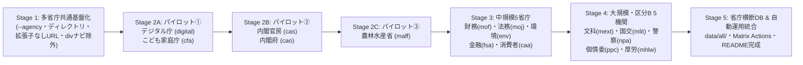

# 他省庁展開（全16機関：防衛省＋区分A・B 15機関）の設計と工程表

2026-11-21 作成。防衛省（`mod`）で構築した審議会等の自動追跡・データベース化・PDF原本保管・Gemini要約システムを、クラウド環境から取得可能な **区分A・B の全15省庁・委員会（防衛省とあわせて計16機関）** に展開するための設計書および工程表。

---

## 1. 対象範囲と優先順位（全16機関）

2026-11-21 の疎通実測に基づき、クラウド環境（GitHub Actions 標準ランナー）からボット検証回避なしで取得可能な 15 機関を 4 つのフェーズに分けて展開する。

| フェーズ | 機関ID | 省庁・委員会名 | 区分 | 主な一覧ページ URL | 条件付き取得 | 構造・規模の特徴 |
|---|---|---|---|---|---|---|
| **稼働中** | `mod` | 防衛省 | A | `https://www.mod.go.jp/j/policy/agenda/meeting/index.html` | `304` | 67会議体・123ページ・PDF 421件（稼働中） |
| **Stage 2A（パイロット1）** | `digital` | デジタル庁 | A | `https://www.digital.go.jp/councils` | `304` | 約70会議体。拡張子なしURL、回次別ページ、RSS完備 |
| **Stage 2A（パイロット1）** | `cfa` | こども家庭庁 | A | `https://www.cfa.go.jp/councils/meetings`<br>`https://www.cfa.go.jp/councils/shingikai` | `304` | 約100会議体・部会。デジタル庁と同一CMS基盤 |
| **Stage 2B（パイロット2）** | `cas` | 内閣官房 | A | `https://www.cas.go.jp/jp/seisaku/index.html`<br>`https://www.cas.go.jp/jp/seisaku/abolition_list.html` | `304` | 約120会議体（廃止分含む）。`mod` の `cas-jieikan` も回収可能 |
| **Stage 2B（パイロット2）** | `cao` | 内閣府 | A | `https://www.cao.go.jp/council.html` | `304` | 約110会議体（法定審議会＋50音順の政策会議・懇談会） |
| **Stage 2C（パイロット3）** | `maff` | 農林水産省 | A | `https://www.maff.go.jp/j/council/index.html`<br>`https://www.maff.go.jp/j/study/index.html` | `304` | `/j/` 配下の静的HTML＋WARP移行運用で防衛省と酷似 |
| **Stage 3（中規模・区分A）** | `mof` | 財務省 | A | `https://www.mof.go.jp/about_mof/councils/index.htm` | `304` | 約55リンク。審議会・研究会・過去分が簡潔に整理 |
| **Stage 3（中規模・区分A）** | `moj` | 法務省 | A | `https://www.moj.go.jp/shingi_index.html`<br>`https://www.moj.go.jp/sonota_index.html` | `304` | 法制審議会等の部会・その他会議・過去分 |
| **Stage 3（中規模・区分A）** | `env` | 環境省 | A | `https://www.env.go.jp/council/`<br>`https://www.env.go.jp/council/sonota.html` | `304` | 中央環境審議会＋その他検討会一覧＋開催情報（`o_info.html`） |
| **Stage 3（中規模・区分A）** | `fsa` | 金融庁 | A | `https://www.fsa.go.jp/singi/` | `304` | 法定審議会＋研究会（設置時期の降順で1ページ集約） |
| **Stage 3（中規模・区分A）** | `caa` | 消費者庁 | A | `https://www.caa.go.jp/notice/conference/` | `304` | 年度別の会議更新一覧＋分野別会議一覧（過去分はWARP） |
| **Stage 4（大規模・区分A/B）** | `mext` | 文部科学省 | A | `https://www.mext.go.jp/b_menu/shingi/main_b5.htm` | `304` | 中教審など審議会の下に分科会・部会・小委員会が多階層で存在 |
| **Stage 4（大規模・区分A/B）** | `mlit` | 国土交通省 | A | `https://www.mlit.go.jp/policy/shingikai/index.html`<br>`https://www.mlit.go.jp/policy/shingikai/shingikaiList.html` | `304` | 300超の部会・小委員会。直近の開催案内一覧ページを併用 |
| **Stage 4（大規模・区分A/B）** | `npa` | 警察庁 | A | `https://www.npa.go.jp/bureau/traffic/council/index.html` ほか各局 | `304` | 局別（生活安全局・刑事局・交通局・警備局等）の一覧ページ群 |
| **Stage 4（大規模・区分A/B）** | `ppc` | 個人情報保護委員会 | B | `https://www.ppc.go.jp/personalinfo/kentohkai/` | なし（`200`） | `Last-Modified` なし。ページ数が少ないため `content_sha256` で判定 |
| **Stage 4（大規模・区分A/B）** | `mhlw` | 厚生労働省 | B | `https://www.mhlw.go.jp/stf/shingi/indexshingi.html`<br>`https://www.mhlw.go.jp/stf/shingi/other-kami.html` | なし（`200`） | 最大規模（約400部会・検討会）。一覧上の `new 月日` 差分で更新部会だけ巡回 |

> **対象外（区分C：クラウドIPから 403/502 の 4 機関）**: 経済産業省（`meti`）、外務省（`mofa`）、公正取引委員会（`jftc`）、総務省（`soumu`）。将来セルフホストランナーまたはブラウザ取得束で追加できるよう、設定スキーマのみ予約しておく。

---

## 2. ディレクトリ構成とリポジトリ再編の方針

既存のデータ（`data/mod/`・`raw/mod/`）および既存の CLI（`python3 mod/update.py` など）の**後方互換性を 100% 保ったまま**、複数省庁を並列に扱える構成へ拡張する。

### 2.1 ディレクトリ構成（変更後）

```text
shingikai/
├── README.md                       全省庁の収録状況・共通スキーマ・運用手順（防衛省固有の記述は docs/agencies/mod.md にも整理）
├── requirements.txt                pdfminer.six（PDF本文抽出用）
├── requirements-llm.txt            google-genai（Phase 3 Gemini用）
├── agencies.json                   各省庁の設定（ベースURL、一覧ページ、対象パス接頭辞、RSS、巡回深さ、本文コンテナ等）
├── mod/                            既存スクリプト群（--agency <id> オプションを追加し、既定値を mod にして互換維持）
│   ├── agencies.py                 新規：agencies.json の読み込みと省庁別ルール（HTML本文領域・URL正規化）
│   ├── pages.py                    拡張：拡張子なしURL対応、HTML5以前の <div id="header|menu|footer"> 読み飛ばし対応
│   ├── ingest_pages.py             拡張：--agency 対応、拡張子なしパスの <path>/index.html 保存
│   ├── check_access.py             拡張：--agency <id|all> で指定省庁または全16機関の疎通を一括確認
│   ├── check_updates.py            拡張：--agency 対応、再帰深さ上限（max_depth）・2段階巡回対応
│   ├── build_db.py                 拡張：--agency 対応、省庁別の一覧ページ解析アダプタ
│   ├── fetch_files.py              拡張：--agency 対応、複数サブドメイン（*.maff.go.jp 等）許可設定
│   ├── archive_pdfs.py             拡張：--agency 対応（Releaseタグ: <agency>-pdfs-YYYY）
│   ├── extract_text.py             拡張：--agency 対応
│   ├── events.py                   拡張：--agency 対応
│   ├── update.py                   拡張：--agency <id> で任意の省庁の日次更新を実行
│   ├── cross_agency.py             新規：全省庁の persons.csv / councils.csv を横断集計し data/all/ を生成
│   └── llm/                        拡張：--agency 対応（省庁別の要約・抽出・検討メモ）
├── raw/
│   ├── mod/                        防衛省（既存そのまま：pages.csv, files.csv, pages/, files/）
│   ├── digital/                    デジタル庁（pages.csv, files.csv, pages/, files/）
│   ├── cfa/                        こども家庭庁
│   ├── cas/                        内閣官房
│   ├── cao/                        内閣府
│   ├── maff/                       農林水産省
│   └── <agency>/                   以降の各省庁も同じ構成
├── data/
│   ├── mod/                        防衛省（既存の 11 表＋text/ そのまま）
│   ├── digital/                    デジタル庁（同じ 11 表＋text/）
│   ├── cfa/                        こども家庭庁
│   ├── cas/                        内閣官房
│   ├── cao/                        内閣府
│   ├── maff/                       農林水産省
│   ├── <agency>/                   以降の各省庁も同じ 11 表
│   └── all/                        新規：省庁横断テーブル
│       ├── agencies.csv            収録省庁一覧と最終更新日時・会議体数・会議数・資料数
│       ├── persons_cross.csv       複数省庁の審議会を兼任する有識者・委員の横断表
│       └── recent_events.csv       全16機関の直近更新イベント統合ビュー
├── checks/
│   ├── mod/                        防衛省の抜き取り検証・Gemini評価レポート（既存ファイルも維持または移動）
│   └── <agency>/                   各省庁の検証シート
└── .github/workflows/
    ├── update.yml                  省庁別マトリクス日次更新（1省庁の失敗が他省庁を止めない構成）
    ├── rss.yml                     RSS対応省庁のフィード取得と3日未取り込み・7日生存監視
    ├── archive_baseline_pdfs.yml   省庁指定（inputs.agency）で初期PDFをReleaseへ一括保管
    └── llm_backfill.yml            省庁指定（inputs.agency）で評価・一括要約
```

---

## 3. パイロット実測で判明した技術課題と解決設計（Stage 1 で実装）

パイロット対象（`digital`, `cfa`, `cas`, `cao`, `maff`）の実ページを [mod/pages.py](file:///home/antigravity/tsuji-y/shingikai/mod/pages.py) で試験解析した結果、防衛省と異なる 4 つの技術的差異が判明した。これを Stage 1（共通基盤の拡張）で吸収する。

### 3.1 拡張子なし URL とディレクトリ名の衝突（`digital`, `cfa`, `caa`, `ppc`）
- **現象**: デジタル庁・こども家庭庁では、会議体トップが `/councils/ai-advisory-board`（拡張子なし）、各回のページが `/councils/ai-advisory-board/162953b0-...` のように同じパスの配下にぶら下がる。そのままファイル名にすると、親ページがファイルとして保存された後に子ページのディレクトリを作れず衝突する。
- **対策**:
  - `ingest_pages.local_path(url)` で、末尾が `.html` / `.htm` でないパスはすべて `<path>/index.html` としてディスクに保存する（台帳 `pages.csv` の `url` 列は元のパス `/councils/ai-advisory-board` を保つ）。既存の `.html` 付き URL（防衛省の全 123 ページ）は一切保存先が変わらない。
  - `discover_html_links()` で、対象プレフィックス配下の拡張子なしパス（PDF・Word・画像等の拡張子を持たないもの）を HTML として扱う。

### 3.2 HTML5 以前のテンプレートにおけるヘッダ・サイドバー除外（`cas`, `cao`, `maff`, `mof`, `mext`, `mhlw`, `mlit`, `env`）
- **現象**: 防衛省は `<header>`, `<nav>`, `<footer>` タグを使っていたため `SKIP_TAGS` だけでメニューを除外できたが、内閣官房（`cas`）や農水省（`maff`）などは `<div id="header">`, `<div id="menu">`, `<div id="side">`, `<div id="footer">` のような `div` ベースのレイアウトになっている。
- **対策**:
  - `pages.py` の `_Parser` で、`role="navigation"` / `role="banner"` / `role="contentinfo"`、および一般的なナビゲーション `id` / `class`（`header`, `footer`, `global-nav`, `gnav`, `sidenav`, `local-nav`, `breadcrumb`, `topicpath`, `pankuzu`, `skip-link` 等）を持つ要素を `SKIP_TAGS` と同様にスキップする。
  - 既存の防衛省 69 テストが 1 件も変わらず通ることを回帰テストで保証する。

### 3.3 3 階層構造（一覧 → 会議体 → 第N回ページ）と巡回深さ制御
- **現象**: 防衛省は多くが「会議体トップの表に全回の資料 PDF が並ぶ」2 階層だが、デジタル庁・こども家庭庁・国交省・厚労省は「会議体トップに『第1回（令和8年7月24日）』への HTML リンクが並び、その先の回次ページに議事次第・資料 PDF・議事録が並ぶ」3 階層構造。
- **対策**:
  - `build_db.py` はすでに「1 回分の会議だけを載せた専用ページ（`found_by=page`）」と「会議体トップの行・見出し」を自動統合する機能（`test_meeting_page_is_merged_with_the_index_row`）を持っている。
  - 回次ページの `<title>` や `<h1>` だけでなく、一覧側のリンク文言（「第1回（令和8年7月24日開催）」）から回次・開催日を子ページへ引き継ぐ補助ルールを足すことで、回次ページの URL が UUID（`/councils/.../162953b0-...`）でも正確に回次・開催日を特定できるようにする。

### 3.4 大規模省庁向けの「2 段階更新チェック」（Stage 4 で活用）
- **現象**: 厚労省・国交省・農水省などは過去の回次ページまで含めると 1 省庁あたり数百〜数千ページになる。過去の完了済み回次ページを毎日すべて GET するのは非効率。
- **対策**:
  - `pages.csv` の各ページを「① 一覧・会議体トップページ（毎回チェック）」と「② 個別の回次詳細ページ（親の会議体トップまたは新着一覧が更新されたとき、または直近 60 日以内のものだけチェック）」に分ける `--tier-mode` を `check_updates.py` に追加する。

---

## 4. 全体工程表（Stage 1 〜 Stage 5）

各 Stage の完了ごとにユニットテストと実地取得結果を報告し、確認を取りながら進める。



### Stage 1：多省庁対応の共通基盤化（リファクタリング）
1. `agencies.json` と `mod/agencies.py` を作成し、各スクリプト（`check_access.py`, `check_updates.py`, `ingest_pages.py`, `build_db.py`, `fetch_files.py`, `archive_pdfs.py`, `extract_text.py`, `events.py`, `update.py`, `mod/llm/`）に `--agency <id>`（既定値 `mod`）を導入する。
2. `ingest_pages.local_path` を拡張し、拡張子なし URL を `<path>/index.html` にマッピングする。
3. `pages.py` に旧式テンプレートのヘッダ・ナビ・フッタ `div` 除外を追加する。
4. **完了条件**: 防衛省（`mod`）の既存 69 テスト＋新規テストがすべて通り、`python3 mod/build_db.py` で既存の `data/mod/` の出力が 1 行も変わらないこと。

### Stage 2：パイロット 3 グループの実装と初回データベース構築

#### Stage 2A：パイロット① デジタル庁（`digital`）・こども家庭庁（`cfa`）
1. 一覧ページ（`digital.go.jp/councils`、`cfa.go.jp/councils/meetings`・`shingikai`）から `councils.csv` を生成。
2. 各会議体ページと回次ページを取得して `raw/digital/`, `raw/cfa/` に保存し、`data/digital/`, `data/cfa/` の各表を構築。
3. 代表的な会議の PDF を取得・本文抽出し、開催日時・場所・出席者・構成員名簿の抽出精度を確認。

#### Stage 2B：パイロット② 内閣官房（`cas`）・内閣府（`cao`）
1. 内閣官房（`cas.go.jp/jp/seisaku/index.html`・`abolition_list.html`）と内閣府（`cao.go.jp/council.html`）の一覧解析アダプタを実装。
2. 防衛省の `councils.csv` に載っていた `cas-jieikan`（自衛官の処遇・勤務環境の改善及び新たな生涯設計の確立に関する関係閣僚会議）を含む各会議体ページを取得し、`data/cas/`, `data/cao/` を構築。

#### Stage 2C：パイロット③ 農林水産省（`maff`）
1. 審議会一覧（`maff.go.jp/j/council/index.html`）と研究会一覧（`maff.go.jp/j/study/index.html`）を取り込み、外局（林野庁 `rinya.maff.go.jp`・水産庁 `jfa.maff.go.jp`）の同一ドメイン配下リンクおよび WARP リンク（`doc_key`）を含めて `data/maff/` を構築。

- **Stage 2 完了条件**: パイロット 5 機関（`digital`, `cfa`, `cas`, `cao`, `maff`）すべてで `councils.csv`〜`documents.csv` が生成され、`update.py --agency <id>` の 2 回目実行が「変更なし」になること。

### Stage 3：中規模・区分 A 5 省庁への展開（`mof`, `moj`, `env`, `fsa`, `caa`）
1. **財務省 (`mof`)**・**法務省 (`moj`)**・**環境省 (`env`)**・**金融庁 (`fsa`)**・**消費者庁 (`caa`)** の設定と一覧抽出ルールを `agencies.json` / `agencies.py` に追加。
2. 各省庁のベースライン HTML 取得・DB 構築・回帰検査を順次実施。
3. **完了条件**: 11 機関（`mod` ＋ Stage 2 の 5 機関 ＋ Stage 3 の 5 機関）で日次更新パイプラインが通ること。

### Stage 4：大規模・区分 A/B 5 機関への展開（`mext`, `mlit`, `npa`, `ppc`, `mhlw`）
1. 2 段階更新チェック（トップ一覧／開催案内一覧の差分から変更部会のみ巡回）を有効化。
2. **個人情報保護委員会 (`ppc`)**・**文部科学省 (`mext`)**・**国土交通省 (`mlit`)**・**警察庁 (`npa`)**・**厚生労働省 (`mhlw`)** のベースライン構築を実施。
3. **完了条件**: 区分 C を除く **全 16 機関** のデータベースが `data/<agency>/` に揃うこと。

### Stage 5：省庁横断テーブル・GitHub Actions 統合・README 刷新
1. **省庁横断集計（`mod/cross_agency.py` → `data/all/`）**:
   - `data/all/agencies.csv`: 全 16 機関の会議体数・会議数・資料数・最終更新日時。
   - `data/all/persons_cross.csv`: 複数の省庁の審議会に名を連ねる有識者・委員の横断テーブル。
2. **GitHub Actions のマトリクス化（`.github/workflows/update.yml`）**:
   - `strategy.matrix.agency`（`fail-fast: false`）で省庁ごとに独立ジョブとして実行し、変更があった省庁をまとめて 1 日 1 回の通知 Issue（または省庁別ラベル付き Issue）に集約する。
3. **README.md とドキュメントの刷新**:
   - トップの `README.md` を「日本政府（全 16 省庁・委員会）の審議会・検討会データベース」として再構成し、各省庁の収録件数一覧とアクセス制約表を掲載する。

---

## 5. 確認・ご判断いただきたい事項

1. **リポジトリ構成**: 単一リポジトリ（この `tsuji-y/shingikai`）の中に `data/<agency>/`・`raw/<agency>/` を並べるモノレポ構成でよいか（横断検索や共通コード保守の面で最も有利です）。
2. **パイロット 5 機関（`digital`, `cfa`, `cas`, `cao`, `maff`）の初期 PDF 取得の範囲**:
   - HTML（会議体一覧・名簿・開催回・資料リンク一覧 `documents.csv`）はパイロット全件を取得し、PDF 本文抽出・Release 保管はまず「議事要旨・議事録・名簿（または直近年度分）」を優先して取得するか、最初から配布資料も含めて全件取得するか。
3. **着手承認**: 上記の **Stage 1（多省庁共通基盤化）→ Stage 2A（デジタル庁・こども家庭庁）** から実装を開始してよいか。
